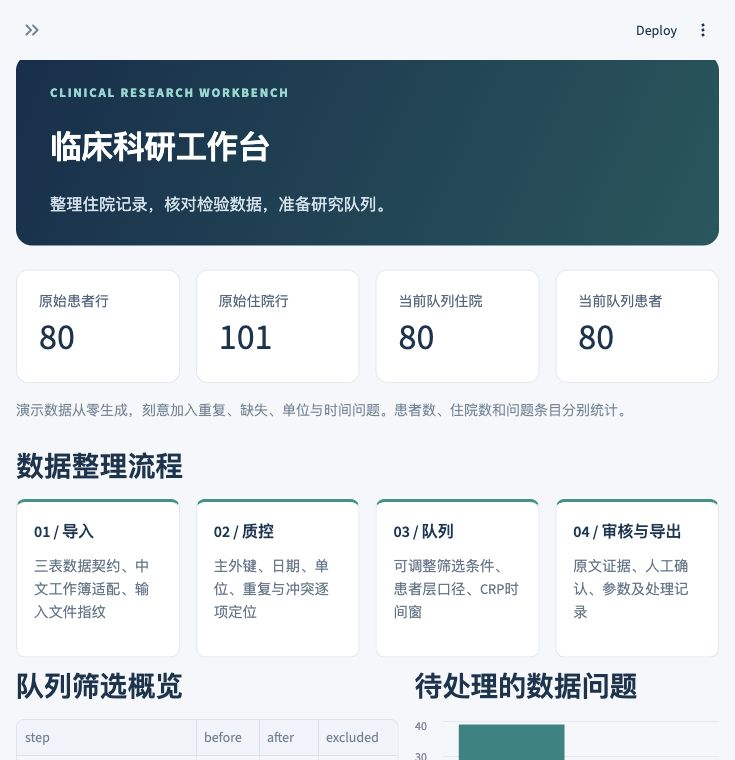

# Clinical Research Workbench

**临床科研数据整理工具**

A tool for preparing retrospective clinical research data: quality checks, cohort filters, descriptive statistics and evidence-linked review. Built with Python, Pandas and Streamlit. Public examples are entirely synthetic.



## 使用场景

脊柱外科回顾性研究资料整理需要反复核对同一患者的多次住院、检验单位、标本、日期和病历原文。原有采集与转换程序解决了资料汇集问题，这个工作台用来继续完成数据检查、候选队列筛选和描述统计，减少在表格与脚本之间反复切换。

已适配“病例总表 / 检验项目明细 / 质量核对”工作簿结构。工作台接收文件，不直接连接医院系统。公开版本只放合成资料，真实研究文件留在本地。

项目始于2026年10月，需求与数据规则来自实际科研资料整理，采用AI辅助开发，目前为本地运行的原型。

## 已实现

| 环节 | 可以实际操作的功能 |
| --- | --- |
| 导入 | 三份UTF-8 CSV、标准三表Excel、已有中文采集整理工作簿适配 |
| 标准化 | 患者—住院—检验分层；文本ID；受控日期解析；支持的检验单位换算；来源指纹 |
| 质控 | 缺失、重复主键、外键、年龄、时间顺序、标本、单位、重复与冲突测量；源表行号定位 |
| 队列 | 年龄、诊断、手术、入院日期；筛选后每人最早一次符合条件住院；患者/住院双口径 |
| 描述统计 | 年龄、住院时长、时间窗内首份准确血清CRP的中位数/IQR与缺失分母；无自动插补 |
| 结构化审核 | 五字段JSON契约、逐字证据与字符位置、未知/阴性/计划区分、逐字段通过/驳回及审核历史 |
| 导出 | CSV、Excel与ZIP；队列流程、质量清单、SHA-256、参数及处理记录；公式前缀转义 |

**病历候选有两种来源：** 无需模型即可体验的预置合成候选，以及可选的本机 Ollama 接口。预置候选不是模型输出；Ollama接口已用模拟服务测试，尚未进行真实模型的抽取准确率评测。任何候选都需要人工确认。

## 5分钟体验

需要 Python 3.12。依赖从PyPI安装；不需要API密钥。首次打开自动加载合成数据。

```bash
python -m venv .venv
```

macOS / Linux：

```bash
source .venv/bin/activate
python -m pip install -r requirements.txt
python -m streamlit run app.py
```

Windows PowerShell（无需修改执行策略）：

```powershell
.\.venv\Scripts\python.exe -m pip install -r requirements.txt
.\.venv\Scripts\python.exe -m streamlit run app.py
```

在浏览器打开 `http://127.0.0.1:8501`。按 **总览 → 质控 → 队列与统计 → 病历结构化 → 导出** 操作；详见[演示步骤](docs/demo-guide.md)。

公开演示部署前必须设置 `CRW_PUBLIC_DEMO=1`，该模式关闭文件上传、自定义病历与模型连接，仅开放合成材料。公开服务的访问控制、资源配额和运维仍由部署者负责。本仓库没有预先部署的在线服务。

## 合成数据与口径

固定随机种子 `20261025`：80个虚构患者、101行住院记录、403行检验结果。刻意加入重复主键、孤立关联、异常年龄、日期逆序、检测界限、超敏CRP、脑脊液标本、测量冲突与重复等问题。

默认参数下：94条住院通过质量门槛，筛选后每人最早一次住院得到80条；其中75条存在窗口内准确血清CRP。质量清单为45个问题条目，**问题条目数不等于患者数或异常记录数**。这些是合成数据回归结果，不能外推为真实医院质量水平。

真实资料不随仓库分发。中文适配器曾在本地授权数据上检查导入规模、键结构、上游标记与源文件不变性；这不构成最终研究纳入、临床语义或医院兼容性的验证。

## 测试与复现

```bash
python -m unittest discover -s tests -v
```

当前版本包含34项测试：19项数据/导入导出、10项结构化与连接边界、5项Streamlit流程。覆盖数据转换与口径中的实际失败情形，测试不接触患者资料、不下载模型。见[验证记录](docs/validation.md)。

## 文档

- [工具设计记录](docs/design-notes.md)：使用场景、数据规则与待办
- [架构与处理规则](docs/architecture.md)：原始/标准化/分析层及审核状态流
- [数据契约](docs/data-contract.md)：三表字段与已有中文格式映射
- [隐私与部署边界](docs/privacy.md)：本地会话、公开演示限制及临床资料处理
- [开源复用记录](docs/third-party-reuse.md)：固定来源与取舍

## 后续迭代

优先加入人工确认后的修订文件重导入、可配置数据字典与真实模型的双人标注评测。SQLite母库、影像评分与医嘱是后续独立适配器；当前版本未将空接口视为已接通数据源。

## License

MIT，见 [LICENSE](LICENSE)。第三方框架与参考项目各按原许可证；当前未复制四个临床/数据候选仓库的实现代码。
