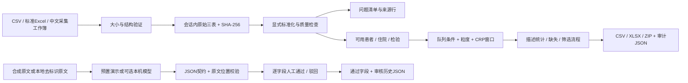

# 架构与规则

## 模块边界

- `crw/data.py`：有界导入、已知中文字段适配、合成生成器。患者、住院、检验各有独立键。
- `crw/pipeline.py`：保留源行的标准化、质量门槛、队列、描述统计和审计。未知不转成否；没有插补。
- `crw/extraction.py`：五字段约束、逐字证据和原文指纹；可选Ollama只连loopback HTTP，禁用环境代理并拒绝重定向。
- `crw/export.py`：内存导出、标识保真及公式前缀转义。
- `app.py`：流程页面与会话状态；不使用跨会话缓存保存输入数据。

## 数据层

**原始层：** 保留导入映射后的原文值和文件指纹，不修改输入文件。标准化过程中丢弃的额外字段不进入三表接口；中文适配明确保留的来源字段例外。

**标准化层：** 行号从Excel/CSV的第2行起；原始层独立保留。错误阻断规则会标记该行不可用；警告可仅提示，也可排除特定测量。质量项是一条检查发现，并非一名患者。

**分析层：** 先排除无效住院，执行纳排过滤，再按需选择每人最早一条符合条件住院。同一测量冲突整组排除；相同测量重复合并并保留来源结果ID。

CRP取已记录住院范围内、入院后设定窗口中的首份准确血清常规CRP；mg/dL按明确规则×10变为mg/L。`<5`保留阈值及比较符，不作为5的准确值进入该指标；其他标本、超敏CRP与全血CRP分开。

## 审核状态

`pending → accepted / rejected`；每次操作追加事件，最新事件决定当前通过结果。审核者必填。原文、候选来源或模型配置变化时，当前候选和本次审核清空；重要记录需要先导出。审核历史中的证据、来源指纹与时间同时保留。

证据匹配验证字符串的存在与位置，不能验证临床语义。模型可能引用真实句子却给出错误状态，因此人工审核是独立步骤。

## 运行边界

本地单进程原型；没有账号、持久数据库或多中心协作。数据只供当前会话计算和用户主动下载，服务器内存可能保留会话到超时回收；不承诺安全擦除。规模受文件/行数限制，限制用于约束资源，不代表已完成上限压力测试。
